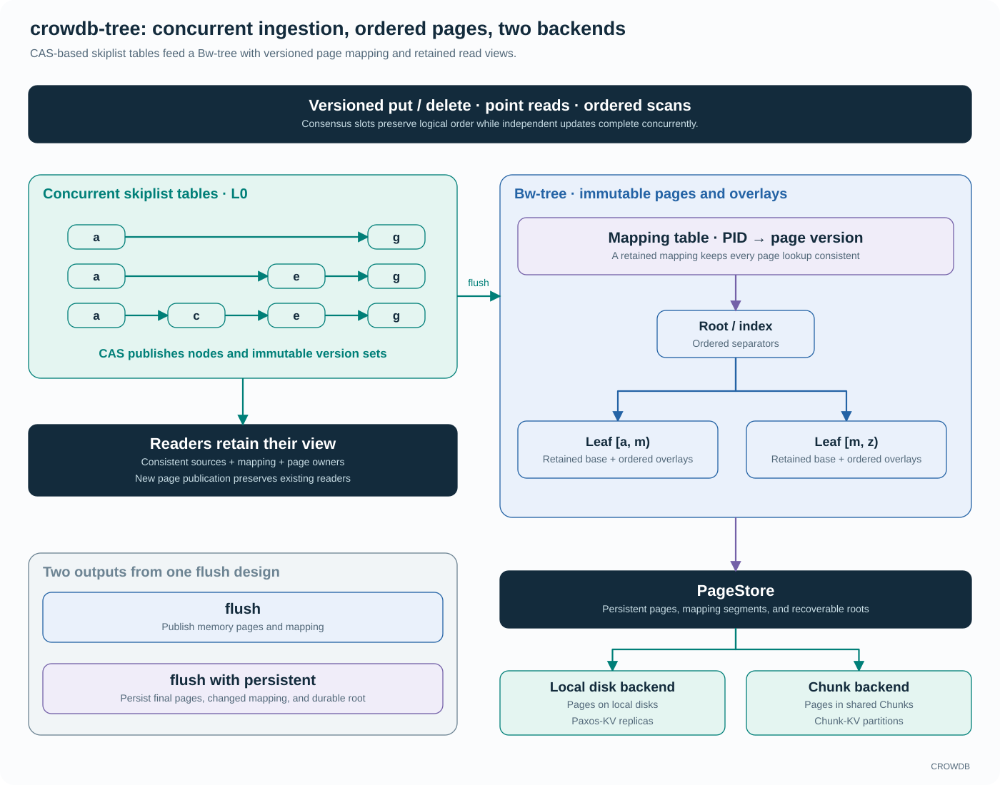
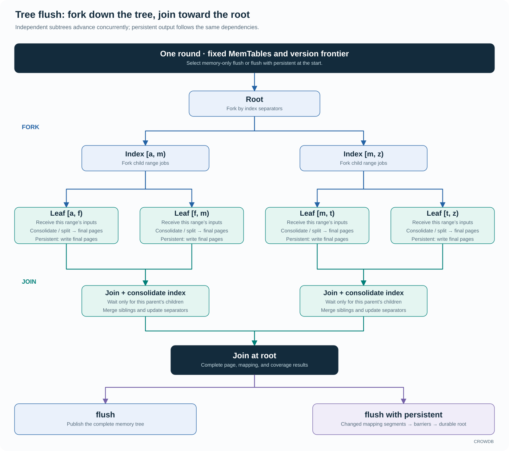

<!-- Copyright 2026-present Gian <crow.db@outlook.com> -->
<!-- Licensed under the Apache License, Version 2.0. -->

# CROWDB - Design: Tree Storage Engine

`crowdb-tree` combines concurrent skiplist write buffers, immutable pages behind a mapping table, and slot-aware version selection in one ordered key-value engine. Flush distributes work across independent subtrees and joins their results toward the root. A flush with persistent writes the resulting changes to local disks or shared Chunk storage.

These choices connect foreground concurrency, ordered reads, and background persistence. Paxos-KV uses the engine on each replica's local disks; Chunk-KV uses its Chunk backend to keep range state independent of the serving node. CROWDB can optimize the same engine for both storage models.

## Concurrent skiplists feed a versioned page tree

Each write buffer, or MemTable, is an ordered concurrent skiplist. Compare-and-swap (CAS) publishes new nodes and links new versions, while epoch protection delays reclamation until readers are finished. Multiple writers can update independent keys without putting every insertion behind a shared MemTable mutex. The skiplist also gives flush jobs ordered range cursors without sorting the entire input batch again.

The page tree resolves each logical page ID to an immutable page version through a versioned mapping table. CROWDB combines this indirection with MemTables, ordered overlays, and incremental persistence. A page's overlays hold updates above its base data. Readers retain a consistent mapping and source view while writers prepare newer state, and a split can share base ranges without immediately copying every value. [Bw-tree paper](https://www.microsoft.com/en-us/research/wp-content/uploads/2016/02/bw-tree-icde2013-final.pdf)

This keeps several expensive operations off the ordinary update path. Inserting a value need not rewrite a disk page; publishing a new page need not invalidate a reader's view; moving entries into the tree can transfer or share their existing allocation owners. Consolidation combines overlays and adjusts page boundaries when the structure needs it.

## Logical versions survive out-of-order application

Each key retains slot information and the versions needed by active read and recovery boundaries. A slot records the operation's logical order, supplied by the caller. An older update that finishes after a newer one cannot overwrite it merely by arriving later. Point reads and ordered scans select the highest eligible version, including tombstones that represent deletion, from the retained sources and pages.

That makes concurrency useful all the way through the replicated write path: consensus establishes logical order, while independent application work can finish in a different physical order. Paxos-KV builds user-facing conditional CAS operations from versioned reads and coordinated chosen writes; Tree's own CAS operations publish its concurrent in-memory state.

## Fork flush down the tree, join results toward the root

The flush design captures a finite set of skiplist tables and a fixed version frontier. Starting at the root, index separators divide the work into child ranges. Each leaf receives all captured updates belonging to its range, then consolidates as soon as its own inputs are ready. Independent subtrees can advance concurrently.

Join follows the reverse dependencies. A parent consumes its children's ordered results, resolves sibling merges and index changes, and returns its result upward. The design avoids a whole-tree handoff barrier before consolidation can begin. A ready subtree can produce its final pages while another branch is still receiving updates.

This is where the tree structure becomes a scheduling advantage. Parallelism follows key ranges and page dependencies, with bounded CPU and I/O work. Waiting for a child or storage completion yields the worker, allowing the shared runtime to advance other ranges and other Trees.

## Flush and flush with persistent share the same work

Ordinary flush publishes the resulting pages and mapping in memory. A flush with persistent selects persistent output at the start of the same fork/join flow. Final pages are encoded and written as their dependencies become ready, parents join those results, and changed mapping segments are persisted. The durable root commits after the required output and storage barriers complete.

Both modes share consolidation, split/merge decisions, and final page layout. Unchanged durable pages and mapping segments keep their existing backing. A persistent round also includes dirty state left by earlier ordinary flushes.

A committed durable root reports the covered operation prefix that the caller can use in its journal retention policy. The engine can pause admission of new writes when MemTable capacity or memory is exhausted. Work already accepted keeps the resources it needs to finish and release space.

## Recovery is part of the engine contract

Tree recovers from its durable root and the caller's journal. Paxos-KV supplies consensus-selected operations from its replica-local write-ahead log (WAL), and Chunk-KV supplies ordered mutations from its partition journal. The engine materializes those operations, preserves their version information, and reports the coverage of the committed root.

Using the caller's journal avoids recording the same mutation twice. Recovery opens the last durable root and replays the required journal suffix.

For example, suppose the caller has completed operations through 120, while the last durable Tree root covers 100. Operations 101–120 must remain recoverable from the caller's journal. After a crash, the caller opens that root and supplies the valid suffix to Tree. In Paxos-KV, consensus determines which operations were chosen; Tree restores their materialized state using the supplied slots. Version selection, including tombstones, prevents an older replayed update from replacing a newer value.

Now suppose a flush with persistent starts writing state through 120. Its page writes can finish at different times. The recoverable boundary advances when the new root and its dependencies are committed. Until then, the previous root and required journal history remain the recovery path.

The caller uses durable coverage together with its replication and retention obligations to decide which journal history can be released. Tree reclaims its own backing after the protected roots and readers release it.

## One engine, local disks or shared Chunks

The local backend writes Tree pages and durable roots to local disks. Paxos-KV combines that local engine with replicated consensus and a local WAL on each replica.

The Chunk backend writes page data and roots through CROWDB's shared storage services. Chunk-KV can reopen the same durable backing from another serving node, reuse page state during range splits, and recover its WAL through ChunkStream. The ordered KV model above the backend stays the same.

This combination is the reason to own the engine. CAS-based ingestion, slot-aware reads, page indirection, subtree concurrency, and incremental persistence can be designed together with the distributed services that consume them. The same investment supports fast local replicas and movable shared-storage ranges.

See the [skiplist implementation](../../lib/crowdb-tree/src/memtable), [mapping table](../../lib/crowdb-tree/include/crowdb-tree/maptable), [C++ interface](../../lib/crowdb-tree/include/crowdb-tree/crowdb-tree.h), and [benchmark guide](../../lib/crowdb-tree/bench/README.md).
